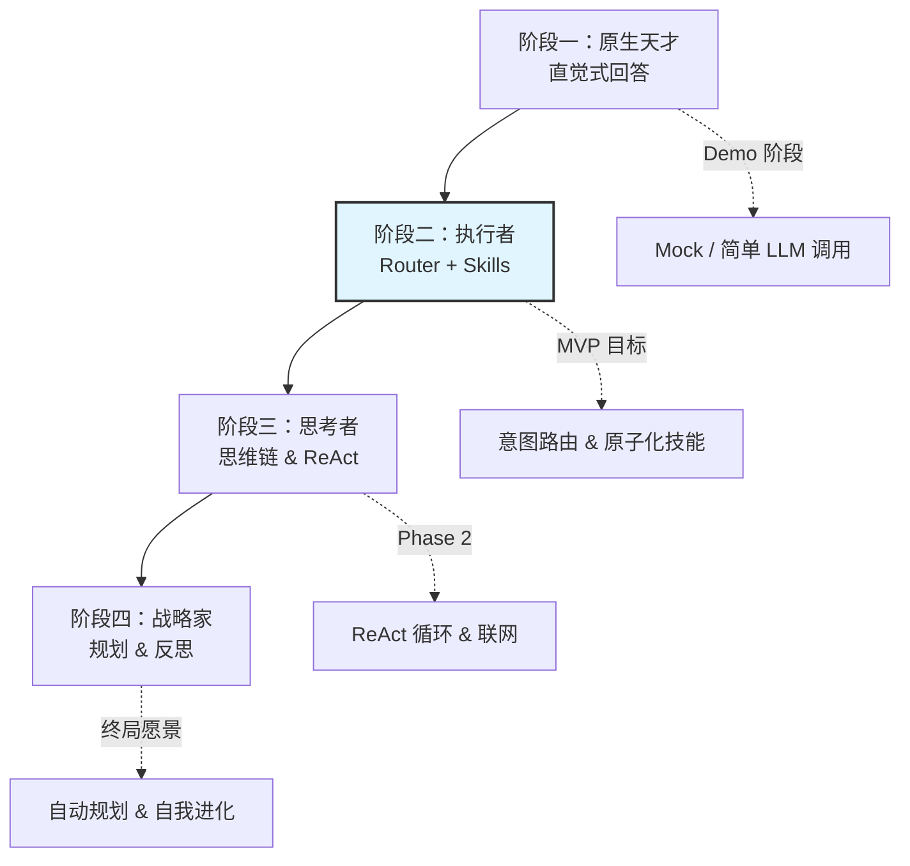
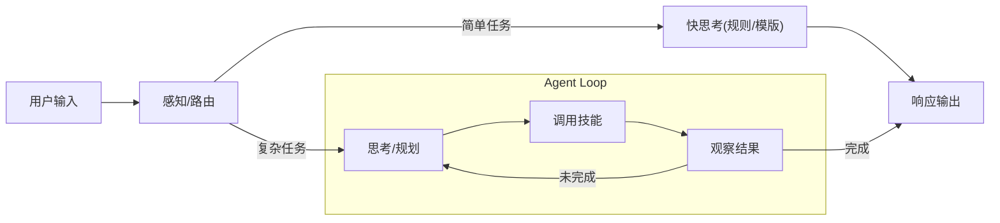
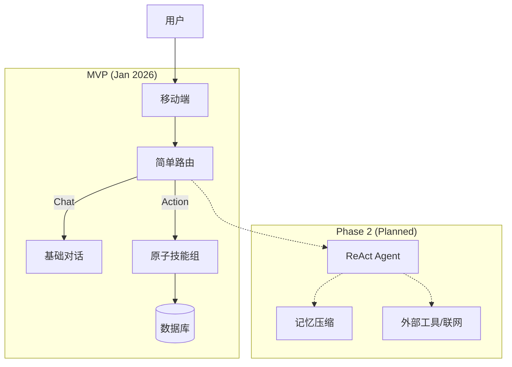

# Flora AI Agent 架构设计完整指南 (v2.1)

> 融合产品愿景、工程落地与长期演进的 Agent 核心设计文档

---

## 📚 核心设计理念

**Agent 不仅仅是大模型，而是"大脑(LLM) + 感知(IO) + 记忆(Memory) + 工具(Skills)"的有机生命体。**

在 Flora 的架构设计中，我们坚持以下原则：
1.  **架构即智能**：不要试图通过堆砌提示词解决所有问题，卓越的流程架构（ReAct/Planning）是智能的倍增器。
2.  **数据为王 (Schema First)**：从第一天起就建立结构化的数据标准，而非依赖非结构化的文本堆积。
3.  **工程平衡**：在追求"深度思考"的同时，必须通过流式交互和乐观UI解决移动端的"等待焦虑"。
4.  **渐进演进**：从 MVP 的"敏捷执行者"逐步进化为终局的"全能专家"。

---

## 一、Flora Agent 的进化路径

我们不追求一步到位，而是遵循"学霸的成长"路径进行产品能力的迭代：

### 1.1 阶段定义
*   **阶段一：原生天才** (Prototype)：依赖 LLM 自身的训练知识，一次性生成，容易产生幻觉。
*   **阶段二：执行者 (MVP 重点)**：引入 **Atomic Skills**（原子化技能），通过 Router 准确识别意图并调用特定能力（如"植物识别"、"病害诊断"）。
*   **阶段三：思考者**：引入 **ReAct** (Reason+Act) 循环，Agent 能够自主使用工具探索未知信息。
*   **阶段四：战略家**：具备 **Planning** (任务规划) 和 **Reflexion** (自我反思) 能力，处理"规划一个花园"这种复杂长程任务。

---

## 二、核心架构：Think-Act-Observe 循环 (System 2)

这是 Flora 的大脑运作机制，区分了"快思考"(Router)和"慢思考"(Agent Loop)。

### 2.1 认知循环模型
**核心观点**：Agent 的本质是一套"认知流程"。

### 2.2 流程的三重价值
1.  **对抗"混沌"**：通过 Planning 将大任务拆解为有序的小步骤。
2.  **对抗"遗忘"**：通过 Memory Compression (记忆压缩) 保持长期记忆。
3.  **对抗"虚无"**：通过 Real-time Tools (工具) 获取真实世界的实时信息。

---

## 三、技能系统 (Skill System) —— Agent 的手脚

技能是 Agent 与世界交互的唯一方式。在 MVP 阶段，**技能的定义与拆分是核心工作**。

### 3.1 原子化技能 (Atomic Skills)
我们必须避免写一个 5000 行的 "God Prompt"。相反，我们定义清晰的原子能力：

| 技能 ID | 名称 | 描述 | 输入 (Input) | 输出 (Output) |
| :--- | :--- | :--- | :--- | :--- |
| `plant_id` | 植物识别 | 识别图片中的植物品种 | Image URL | Plant Name, Species, Confidence |
| `diagnosis` | 病害诊断 | 分析植物健康状况及成因 | Plant ID, Image/Desc | Disease Name, Severity, Context |
| `care_plan` | 养护生成 | 生成基础养护计划 | Species, Environment | Water Freq, Light Req, Temp Range |
| `reminder_set` | 提醒设置 | 设定系统级通知 | Plant ID, Action, Time | Success/Fail Metadata |

### 3.2 技能路由 (Router)
*   **MVP 策略**：使用简单的 Semantic Router (语义路由) 或 LLM Classifier。
*   **逻辑**：用户输入 -> 嵌入向量/关键词 -> 匹配 Skill -> 提取参数 (Slot Filling) -> 执行。

---

## 四、上下文工程 (Context Engineering)

上下文是 LLM 的短期记忆。如果不加管理，随着对话变长，Token 消耗将呈指数级增长，且模型注意力会涣散。

### 4.1 核心策略：渐进式披露 (Progressive Disclosure)
这是一种"按需加载"的高级策略，虽然在 MVP 阶段不做全量实现，但需理解其思想以预留架构接口。

**三层架构设计**：
1.  **元数据层 (Metadata)**：始终加载。包含 Flora 人设、当前植物列表(摘要)、技能列表。*（轻量，<500 tokens）*
2.  **详情层 (Details)**：按需加载。当 Router 命中"诊断"技能时，才加载"诊断指南"和"过往病史"。
3.  **资源层 (Resources)**：动态查找。RAG 检索到的具体文章、知识库片段。

### 4.2 记忆压缩 (Memory Compression)
*   **原始交互**：`User: "叶子黄了"`, `Agent: "浇水多了"`
*   **压缩记忆**：`Insight: 用户经常因为过度关心而浇水过多 (Confidence: 0.9)`
*   **价值**：用 50 个 token 记住 5000 个 token 发生的关键信息。

---

## 五、工程现实与用户体验 (Engineering & UX)

仅仅有强大的 Agent 思考模型是不够的。在移动端 C 侧应用中，**"等待感"是用户体验的杀手**。

### 5.1 流式响应与首字延迟 (TTFT)
**问题**：ReAct 循环可能导致 5-10 秒的延迟。让用户盯着空白屏幕等待是不可接受的。

**解决方案**：
1.  **强制双流输出 (Dual-Stream Protocol)**：
    *   **Thought Stream (思考流)**：将 Agent 的"内心戏"（正在识别图片...正在查询知识库...）实时推送到客户端的状态栏或 Loading 气泡中。
    *   **Content Stream (内容流)**：一旦生成最终回复，立即 Token-by-Token 渲染。

2.  **乐观 UI (Optimistic UI)**：
    *   在用户上传图片的瞬间，客户端立即展示"正在识别..."，同时后台开始预热模型。

### 5.2 优雅降级 (Graceful Degradation)
1.  **Timeout 熔断**：如果 Agent 5秒内未产出行动，强制降级为基础对话模型，先安抚用户。
2.  **离线能力**：核心的"我的花园"列表和"浇水提醒"必须支持 Local-First，不依赖网络。

---

## 六、MVP 阶段战略聚焦 (Jan 2026)

基于上述宏大架构，我们在 MVP 阶段做**极度克制的减法**。

### 6.1 MVP 必做清单 (Must-Haves)
1.  **数据结构规范 (Schema First)**：
    *   **Action**：确立 `Message`, `Interaction`, `PlantProfile` 的结构化设计。即使现在不压缩记忆，也要把 `Intent`、`SkillID` 等字段存下来，通过 Schema 积累数据资产。
    *   *原因*：现在的"垃圾文本"会导致未来无法进行数据挖掘。

2.  **原子化技能拆分 (Atomic Skills)**：
    *   **Action**：将"诊断"、"养护"、"闲聊"拆分为独立的 Prompt 模块。
    *   *原因*：模块化是系统可维护性的前提。

3.  **基础流式架构 (Streaming)**：
    *   **Action**：前后端通讯协议支持 SSE。
    *   *原因*：体验基线，不可妥协。

### 6.2 MVP 暂缓清单 (Nice-to-Haves)
1.  **复杂的自我反思 (Reflexion)**：
    *   *策略*：MVP 使用 **Router -> One-Shot** 模式。出错暂不自动重试。
2.  **三层渐进式披露**：
    *   *策略*：MVP 直接加载最近 10 条对话 + 简化的植物档案。
3.  **自动规划 (Auto-Planning)**：
    *   *策略*：对于"养护计划"，使用预设的**规则模板**，而非让 AI 现场规划。

### 6.3 实施路线图建议

---

## 📚 附录：核心参考资源

*   **Papers**: Chain-of-Thought (CoT), ReAct, Reflexion Framework.
*   **Industry**: Anthropic's "Model Context Protocol" (MCP), LangChain Design Patterns.

**(文档版本 v2.1 | 维护者：Flora 架构组)**
