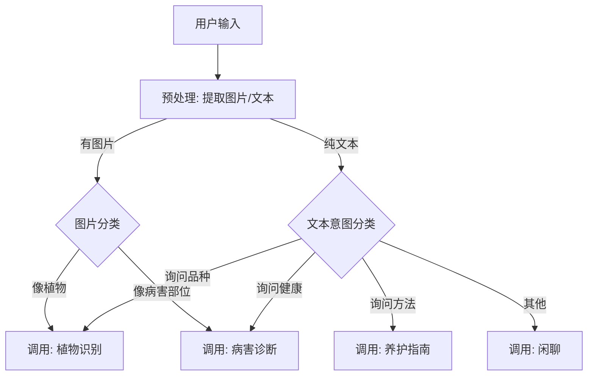

# Flora AI Skill 系统设计文档 (v2.1)

> 对应架构文档 v2.1，聚焦原子化技能定义与 MVP 落地

---

## 一、技能系统总览 (Skill System Overview)

### 1.1 设计原则
1.  **原子化 (Atomic)**：每个 Skill 只做一件事，不仅方便 Router 路由，也方便未来 Agent 自主编排。
2.  **结构化 (Structured)**：输入输出严格 Schema 化，拒绝纯文本交互，为 UI 渲染和数据挖掘服务。
3.  **无状态 (Stateless)**：Skill 本身不持有对话状态，所有状态由 Context 传入。

### 1.2 技能分类与 MVP 规划

| 类别 | 技能 ID | 技能名称 | 描述 | MVP 状态 |
| :--- | :--- | :--- | :--- | :--- |
| **核心能力** | `plant_identify` | 植物识别 | 识别图片中的植物品种 | ✅ **Must** |
| | `disease_diagnosis` | 病害诊断 | 诊断植物健康问题 | ✅ **Must** |
| | `care_guide` | 养护指南 | 查询特定植物的养护知识 | ✅ **Must** |
| **用户交互** | `chat_chit_chat` | 闲聊/百科 | 处理非功能性的植物问答 | ✅ **Must** |
| | `user_intent` | 意图识别 | (内部) 路由分发器 | ✅ **Must** |
| **花园管理** | `reminder_set` | 设置提醒 | 创建浇水/施肥提醒 | ⚠️ **Nice-to-have** |
| | `plant_add` | 添加植物 | 将识别结果存入花园 | ⚠️ **Nice-to-have** |
| **高级能力** | `garden_planning` | 花园规划 | 针对环境的复杂规划 | ❌ **Phase 2** |
| | `data_report` | 数据周报 | 生成养护数据分析 | ❌ **Phase 2** |

---

## 二、核心技能定义 (MVP Must-Haves)

### 2.1 植物识别 (plant_identify)

**功能**：通过图片识别植物，返回品种信息和置信度。
**触发**：用户发送图片，或明确询问"这是什么植物"。

#### Schema Definition
```typescript
interface PlantIdentifyInput {
  image_url: string; // 图片地址
  user_remark?: string; // 用户附带的文字（如"这是我在路边看到的"）
}

interface PlantIdentifyOutput {
  status: 'success' | 'uncertain' | 'fail';
  result?: {
    name: string;      // 中文名 (e.g. "龟背竹")
    scientific_name: string; // 学名 (e.g. "Monstera deliciosa")
    confidence: number; // 0.0 - 1.0
    description: string; // 简短介绍
    tags: string[];    // 特征标签 (e.g. ["耐阴", "观叶"])
  };
  ui_component: 'plant_card'; // 客户端渲染卡片组件
}
```

**流式反馈 (Streaming UX)**：
*   Step 1: "正在分析图像特征..." (UI: Loading Spinner)
*   Step 2: "识别到叶片特征..."
*   Step 3: (Output JSON) -> 渲染结果卡片

---

### 2.2 病害诊断 (disease_diagnosis)

**功能**：基于图片或描述，分析植物健康问题。
**触发**：用户上传问题部位图片，或描述"叶子黄了"。

#### Schema Definition
```typescript
interface DiagnosisInput {
  plant_id?: string;   // 如果是花园里的植物
  image_urls?: string[];
  symptoms: string[];  // 症状描述 (e.g. ["叶尖发黑", "有斑点"])
  environment?: {      // 补充环境信息
    location?: string;
    light?: string;
  };
}

interface DiagnosisOutput {
  diagnosis: {
    disease_name: string; // 病害名称 (e.g. "炭疽病")
    severity: 'low' | 'medium' | 'high';
    confidence: number;
    analysis: string;     // 原因分析
  };
  solutions: {
    step: number;
    action: string;       // 具体行动 (e.g. "修剪病叶")
    tool?: string;        // 所需工具 (e.g. "剪刀")
  }[];
  disclaimer: string;     // "建议仅供参考，严重情况请咨询专家"
  ui_component: 'diagnosis_report'; // 客户端渲染诊断报告
}
```

---

### 2.3 养护指南 (care_guide)

**功能**：提供特定植物的基础养护知识（光照、浇水、温度）。
**触发**：用户问"龟背竹怎么养"或点击"查看养护"。

#### Schema Definition
```typescript
interface CareGuideInput {
  plant_name: string;
  context?: 'summer' | 'winter'; // 季节上下文
}

interface CareGuideOutput {
  plant_name: string;
  guides: {
    water: { frequency: string; tips: string };
    light: { requirement: string; tips: string };
    soil: { type: string; tips: string };
    temp: { range: string; tips: string };
  };
  one_sentence_summary: string; // 一句话总结 (e.g. "喜阴怕涝，注意通风")
  ui_component: 'care_card';
}
```

---

## 三、通用技能与路由 (Common & Router)

### 3.1 闲聊/百科 (chat_chit_chat)

**功能**：处理非功能性对话，保持"Flora"的人设。
**触发**：无法匹配到特定功能 Intent 时的兜底。

**System Prompt 片段**：
> 保持友好、专业但不过度热情的植物专家人设。不要胡编乱造植物知识。如果是无法回答的非植物问题，礼貌拒绝。

### 3.2 意图路由 (Router Logic)

在 MVP 阶段， Router 是一个基于规则 + 轻量 LLM 的分类器。



---

## 四、未来扩展接口 (Next Phase)

### 4.1 花园规划 (garden_planning)
*   **输入**：房间照片、光照朝向、用户生活习惯。
*   **输出**：植物搭配清单、摆放位置建议图。
*   **技术难点**：需要多模态理解空间结构，属于 Phase 2 重点。

### 4.2 数据周报 (data_report)
*   **输入**：用户过去一周的浇水/打卡记录。
*   **输出**：文字总结 + 图表数据。
*   **依赖**：需要先建立完善的 User Activity 数据库。

---

**(文档版本 v2.1 | 更新时间：2026-01 | 状态：MVP 已锁定)**