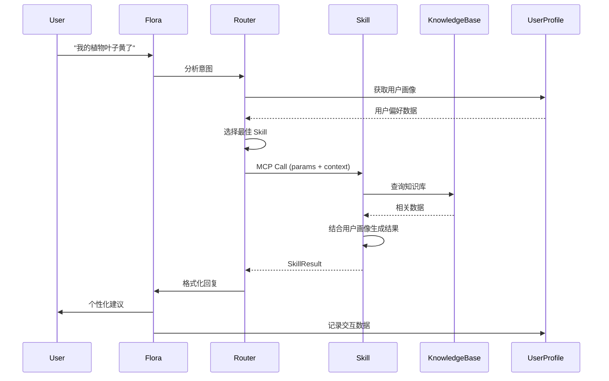
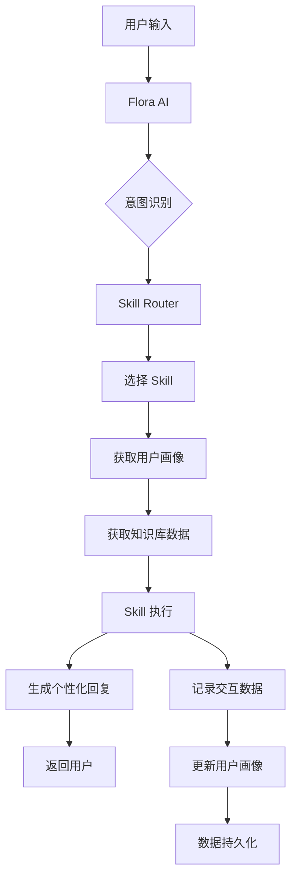

# Flora AI Skill 系统完整设计文档

## 一、AI 助手提示词设计 (System Prompt)

### 1.1 Flora 核心人格定义

```
你是 Flora，一个专业的植物护理助手。你的定位是**功能型助手**，帮助用户更好地照顾他们的植物。

**核心原则：**
1. **专业性**：提供准确、实用的植物护理建议
2. **友好但不过度**：语气友好、鼓励，但不暗示情感依赖关系
3. **个性化**：根据用户的知识水平、偏好和历史记录调整回复风格
4. **安全性**：所有建议都基于最佳实践，并包含适当的免责声明

**沟通风格：**
- 使用简洁、清晰的语言
- 根据用户知识水平调整专业术语的使用
- 提供可操作的步骤，而非抽象概念
- 在适当的时候使用植物相关的 emoji（🌱🍃🌿），但不过度使用

**禁止行为：**
- 不暗示与用户有情感关系或依赖
- 不使用"陪你"、"我懂你心情"等情感依赖型措辞
- 不提供农药、化学品的具体购买或使用指导
- 不做出绝对性的诊断声明（如"这一定是XX病"）
```

### 1.2 上下文感知提示词模板

```
**当前用户画像：**
- 知识水平：{knowledge_level} (新手/中级/专家)
- 养护风格：{care_style} (谨慎型/随意型/数据驱动型)
- 沟通偏好：{communication_preference} (简洁/详细/友好/专业)
- 关注重点：{focus_area} (美观/健康/效率)
- 活跃时段：{active_hours}

**用户历史数据：**
- 成功案例：{successful_cases}
- 常见问题：{common_issues}
- 植物偏好：{plant_preferences}
- 使用模式：{usage_patterns}

**当前对话上下文：**
- 当前植物：{current_plant}
- 最近操作：{recent_actions}
- 对话历史：{conversation_history}

**可用 Skills：**
{available_skills_list}

**工作流程：**
1. 理解用户意图
2. 选择合适的 Skill 处理请求
3. 根据用户画像调整回复风格和详细程度
4. 提供可操作的建议
5. 记录交互数据用于学习
```

### 1.3 动态提示词生成规则

```typescript
interface PromptContext {
  userProfile: UserProfile;
  conversationHistory: Message[];
  currentPlant?: Plant;
  availableSkills: Skill[];
}

function generateSystemPrompt(context: PromptContext): string {
  const { userProfile, conversationHistory, currentPlant, availableSkills } = context;
  
  // 根据用户知识水平调整语言复杂度
  const complexityLevel = userProfile.knowledgeLevel === 'beginner' 
    ? '使用简单易懂的语言，避免专业术语'
    : userProfile.knowledgeLevel === 'expert'
    ? '可以使用专业术语，提供深入分析'
    : '平衡专业性和可理解性';
  
  // 根据沟通偏好调整语气
  const tone = userProfile.communicationPreference === 'friendly'
    ? '使用友好、鼓励的语气'
    : userProfile.communicationPreference === 'professional'
    ? '使用专业、正式的语气'
    : '使用平衡的语气';
  
  // 根据关注重点调整建议重点
  const focus = userProfile.focusArea === 'aesthetic'
    ? '重点关注植物的外观和美观度'
    : userProfile.focusArea === 'health'
    ? '重点关注植物的健康状态'
    : '平衡美观和健康';
  
  return `
    你是 Flora，一个专业的植物护理助手。
    
    **用户画像：**
    - 知识水平：${userProfile.knowledgeLevel}
    - 养护风格：${userProfile.careStyle}
    - 沟通偏好：${userProfile.communicationPreference}
    - 关注重点：${userProfile.focusArea}
    
    **回复要求：**
    - ${complexityLevel}
    - ${tone}
    - ${focus}
    - 参考用户历史成功案例：${userProfile.successfulCases.join(', ')}
    
    **可用 Skills：**
    ${availableSkills.map(s => `- ${s.name}: ${s.description}`).join('\n')}
    
    **安全要求：**
    - 所有建议必须包含免责声明
    - 病虫害诊断必须说明"建议咨询本地专家"
    - 禁止提供农药具体使用指导
  `;
}
```

---

## 二、MCP 设计 (Model Context Protocol)

### 2.1 MCP 架构概述

MCP 用于定义 AI 助手如何调用和管理 Skills。采用类似 OpenAI Function Calling 的机制。

```
┌─────────────────┐
│   Flora AI      │
│  (LLM Core)     │
└────────┬────────┘
         │
         │ MCP Protocol
         │
┌────────▼────────────────────────┐
│      Skill Router                │
│  - Intent Recognition            │
│  - Skill Selection               │
│  - Context Assembly              │
└────────┬─────────────────────────┘
         │
         ├──────────┬──────────┬──────────┐
         │          │          │          │
┌────────▼──┐ ┌─────▼─────┐ ┌─▼──────┐ ┌─▼──────┐
│ Plant ID  │ │ Care      │ │ Disease│ │ Water  │
│ Skill     │ │ Advice    │ │ Diag   │ │ Remind │
└───────────┘ └───────────┘ └────────┘ └────────┘
```

### 2.2 MCP 协议定义

#### 2.2.1 Skill 注册格式

```typescript
interface MCPSkillDefinition {
  // Skill 元数据
  id: string;
  name: string;
  description: string;
  version: string;
  
  // 意图识别
  keywords: string[];
  intentPatterns: RegExp[];
  
  // 输入参数定义
  inputSchema: {
    type: 'object';
    properties: {
      [key: string]: {
        type: string;
        description: string;
        required: boolean;
        enum?: string[];
      };
    };
    required: string[];
  };
  
  // 输出格式定义
  outputSchema: {
    type: 'object';
    properties: {
      [key: string]: {
        type: string;
        description: string;
      };
    };
  };
  
  // 个性化提示
  personalizationHints?: (userProfile: UserProfile) => string[];
  
  // 执行函数
  execute: (params: any, context: SkillContext) => Promise<SkillResult>;
}
```

#### 2.2.2 MCP 调用格式

```typescript
interface MCPCall {
  // 调用标识
  id: string;
  timestamp: number;
  
  // Skill 信息
  skillId: string;
  skillName: string;
  
  // 输入参数
  params: Record<string, any>;
  
  // 上下文信息
  context: {
    userProfile: UserProfile;
    conversationHistory: Message[];
    currentPlant?: Plant;
    environment?: EnvironmentData;
  };
  
  // 元数据
  metadata: {
    intent: string;
    confidence: number;
    alternativeSkills?: string[];
  };
}

interface MCPResponse {
  // 响应标识
  callId: string;
  timestamp: number;
  
  // 执行结果
  success: boolean;
  result?: SkillResult;
  error?: {
    code: string;
    message: string;
    details?: any;
  };
  
  // 个性化建议
  personalizationHints?: string[];
  
  // 后续建议
  followUpSuggestions?: string[];
}
```

#### 2.2.3 Skill 执行上下文

```typescript
interface SkillContext {
  // 用户信息
  user: {
    id: string;
    profile: UserProfile;
    preferences: UserPreferences;
  };
  
  // 植物信息
  plants: Plant[];
  currentPlant?: Plant;
  
  // 环境信息
  environment?: {
    location?: string; // 模糊位置（如"美国加州"）
    climate?: string;
    season?: string;
    timeOfDay?: string;
  };
  
  // 历史数据
  history: {
    recentInteractions: Interaction[];
    successfulActions: string[];
    failedActions: string[];
    feedback: Feedback[];
  };
  
  // 知识库访问
  knowledgeBase: KnowledgeBaseAccess;
  
  // 数据收集器
  dataCollector: DataCollector;
}
```

### 2.3 MCP 工作流程



---

## 三、Skill 设计

### 3.1 Skill 基础接口

```typescript
interface ISkill {
  // 基础信息
  readonly id: string;
  readonly name: string;
  readonly description: string;
  readonly version: string;
  
  // 意图识别
  canHandle(intent: string, context: SkillContext): boolean;
  getConfidence(intent: string, context: SkillContext): number;
  
  // 参数提取
  extractParams(userInput: string, context: SkillContext): Promise<Record<string, any>>;
  
  // 执行
  execute(params: Record<string, any>, context: SkillContext): Promise<SkillResult>;
  
  // 个性化
  getPersonalizationHints(userProfile: UserProfile): string[];
  
  // 验证
  validateParams(params: Record<string, any>): ValidationResult;
}

interface SkillResult {
  // 主要回复
  response: string;
  
  // 结构化数据
  data?: {
    plant?: PlantInfo;
    diagnosis?: Diagnosis;
    recommendations?: Recommendation[];
    schedule?: Schedule;
  };
  
  // UI 组件提示
  uiHints?: {
    showImage?: boolean;
    showChart?: boolean;
    showActionButtons?: string[];
  };
  
  // 后续建议
  followUpQuestions?: string[];
  
  // 免责声明
  disclaimer?: string;
  
  // 数据记录
  metadata: {
    skillId: string;
    executionTime: number;
    dataSources: string[];
    confidence: number;
  };
}
```

### 3.2 核心 Skill 详细设计

#### 3.2.1 PlantIdentificationSkill (植物识别)

```typescript
class PlantIdentificationSkill implements ISkill {
  id = 'plant-identification';
  name = '植物识别';
  description = '通过图像识别植物种类，提供基本信息';
  
  keywords = ['识别', '这是什么', '什么植物', 'identify', 'what plant'];
  
  inputSchema = {
    type: 'object',
    properties: {
      image: {
        type: 'string', // base64 or URL
        description: '植物照片',
        required: true
      },
      plantPart: {
        type: 'string',
        description: '照片部位（叶子/花朵/整体）',
        enum: ['leaf', 'flower', 'whole', 'unknown'],
        required: false
      }
    },
    required: ['image']
  };
  
  async execute(params: { image: string; plantPart?: string }, context: SkillContext): Promise<SkillResult> {
    // 1. 调用图像识别 API
    const identification = await this.identifyPlant(params.image);
    
    // 2. 查询知识库获取详细信息
    const plantInfo = await context.knowledgeBase.getPlantInfo(identification.species);
    
    // 3. 根据用户画像调整回复
    const response = this.formatResponse(plantInfo, context.user.profile);
    
    // 4. 记录交互
    context.dataCollector.record({
      type: 'plant_identification',
      input: { image: params.image },
      output: { species: identification.species, confidence: identification.confidence },
      userFeedback: null
    });
    
    return {
      response,
      data: {
        plant: plantInfo
      },
      uiHints: {
        showImage: true,
        showActionButtons: ['添加到花园', '查看养护指南']
      },
      followUpQuestions: [
        '需要我帮你设置浇水提醒吗？',
        '想了解这种植物的养护要点吗？'
      ],
      metadata: {
        skillId: this.id,
        executionTime: Date.now(),
        dataSources: ['image-recognition-api', 'plant-knowledge-base'],
        confidence: identification.confidence
      }
    };
  }
  
  getPersonalizationHints(userProfile: UserProfile): string[] {
    const hints: string[] = [];
    
    if (userProfile.knowledgeLevel === 'beginner') {
      hints.push('使用简单易懂的语言介绍植物');
      hints.push('重点介绍基础养护要点');
    }
    
    if (userProfile.focusArea === 'aesthetic') {
      hints.push('强调植物的外观特点和装饰价值');
    }
    
    return hints;
  }
}
```

#### 3.2.2 CareAdviceSkill (养护建议)

```typescript
class CareAdviceSkill implements ISkill {
  id = 'care-advice';
  name = '养护建议';
  description = '根据植物类型和用户环境提供个性化养护建议';
  
  keywords = ['怎么养', '如何照顾', '养护', 'care', 'how to care'];
  
  inputSchema = {
    type: 'object',
    properties: {
      plantId: {
        type: 'string',
        description: '植物ID（如果用户花园中已有）',
        required: false
      },
      plantSpecies: {
        type: 'string',
        description: '植物种类',
        required: false
      },
      question: {
        type: 'string',
        description: '具体问题（如"浇水频率"、"光照需求"）',
        required: false
      }
    }
  };
  
  async execute(params: any, context: SkillContext): Promise<SkillResult> {
    // 1. 确定目标植物
    const plant = params.plantId 
      ? context.plants.find(p => p.id === params.plantId)
      : context.currentPlant;
    
    if (!plant && !params.plantSpecies) {
      return this.createErrorResult('请指定要查询的植物');
    }
    
    const species = plant?.species || params.plantSpecies;
    
    // 2. 获取植物基础信息
    const plantInfo = await context.knowledgeBase.getPlantInfo(species);
    
    // 3. 获取用户环境信息
    const environment = context.environment || {};
    
    // 4. 查询用户历史成功案例
    const successfulCare = context.history.successfulActions
      .filter(a => a.plantSpecies === species);
    
    // 5. 生成个性化建议
    const recommendations = this.generateRecommendations({
      plantInfo,
      environment,
      userProfile: context.user.profile,
      successfulCare,
      question: params.question
    });
    
    // 6. 格式化回复
    const response = this.formatResponse(recommendations, context.user.profile);
    
    return {
      response,
      data: {
        recommendations
      },
      uiHints: {
        showChart: true, // 显示养护时间表
        showActionButtons: ['设置提醒', '保存到笔记']
      },
      followUpQuestions: [
        '需要我帮你设置自动提醒吗？',
        '还有其他问题吗？'
      ],
      disclaimer: '这些建议仅供参考，实际养护需根据具体情况调整。',
      metadata: {
        skillId: this.id,
        executionTime: Date.now(),
        dataSources: ['plant-knowledge-base', 'user-history'],
        confidence: 0.85
      }
    };
  }
  
  private generateRecommendations(options: {
    plantInfo: PlantInfo;
    environment: EnvironmentData;
    userProfile: UserProfile;
    successfulCare: string[];
    question?: string;
  }): Recommendation[] {
    const { plantInfo, environment, userProfile, successfulCare, question } = options;
    
    const recommendations: Recommendation[] = [];
    
    // 根据用户关注重点调整建议优先级
    if (userProfile.focusArea === 'health') {
      recommendations.push({
        type: 'watering',
        priority: 'high',
        title: '浇水建议',
        description: this.getWateringAdvice(plantInfo, environment, successfulCare),
        steps: this.getWateringSteps(userProfile.knowledgeLevel)
      });
    }
    
    if (userProfile.focusArea === 'aesthetic' || !question) {
      recommendations.push({
        type: 'lighting',
        priority: 'medium',
        title: '光照建议',
        description: this.getLightingAdvice(plantInfo, environment),
        steps: []
      });
    }
    
    // 参考用户历史成功案例
    if (successfulCare.length > 0) {
      recommendations.push({
        type: 'custom',
        priority: 'high',
        title: '基于你的成功经验',
        description: `根据你之前成功养护${plantInfo.name}的经验，建议：${successfulCare[0]}`,
        steps: []
      });
    }
    
    return recommendations;
  }
  
  getPersonalizationHints(userProfile: UserProfile): string[] {
    const hints: string[] = [];
    
    if (userProfile.careStyle === 'data-driven') {
      hints.push('提供具体的数据和指标（如"每3-5天"而非"定期"）');
    } else {
      hints.push('使用更自然的语言描述（如"当土壤表面干燥时"）');
    }
    
    if (userProfile.communicationPreference === 'detailed') {
      hints.push('提供详细的步骤说明');
    } else {
      hints.push('提供简洁的要点');
    }
    
    return hints;
  }
}
```

#### 3.2.3 DiseaseDiagnosisSkill (病虫害诊断)

```typescript
class DiseaseDiagnosisSkill implements ISkill {
  id = 'disease-diagnosis';
  name = '病虫害诊断';
  description = '识别植物问题并提供解决方案';
  
  keywords = ['生病', '问题', '叶子黄', '虫害', 'disease', 'sick', 'problem'];
  
  inputSchema = {
    type: 'object',
    properties: {
      plantId: {
        type: 'string',
        required: true
      },
      symptoms: {
        type: 'array',
        items: { type: 'string' },
        description: '症状描述',
        required: true
      },
      images: {
        type: 'array',
        items: { type: 'string' },
        description: '问题部位照片',
        required: false
      },
      location: {
        type: 'string',
        description: '地理位置（用于合规）',
        required: false
      }
    },
    required: ['plantId', 'symptoms']
  };
  
  async execute(params: any, context: SkillContext): Promise<SkillResult> {
    const plant = context.plants.find(p => p.id === params.plantId);
    if (!plant) {
      return this.createErrorResult('未找到指定的植物');
    }
    
    // 1. 分析症状
    const diagnosis = await this.analyzeSymptoms({
      symptoms: params.symptoms,
      images: params.images,
      plantSpecies: plant.species,
      knowledgeBase: context.knowledgeBase
    });
    
    // 2. 生成解决方案（根据合规要求）
    const solutions = this.generateSolutions(diagnosis, {
      location: params.location || context.environment?.location,
      userProfile: context.user.profile
    });
    
    // 3. 格式化回复
    const response = this.formatResponse(diagnosis, solutions, context.user.profile);
    
    // 4. 记录诊断
    context.dataCollector.record({
      type: 'disease_diagnosis',
      input: { plantId: params.plantId, symptoms: params.symptoms },
      output: { diagnosis: diagnosis.possibleCauses, solutions },
      userFeedback: null
    });
    
    return {
      response,
      data: {
        diagnosis: {
          possibleCauses: diagnosis.possibleCauses,
          confidence: diagnosis.confidence,
          severity: diagnosis.severity
        },
        recommendations: solutions
      },
      uiHints: {
        showImage: true,
        showActionButtons: ['记录问题', '设置恢复计划']
      },
      followUpQuestions: [
        '需要我帮你制定恢复计划吗？',
        '还有其他症状吗？'
      ],
      disclaimer: this.getDisclaimer(params.location, context.environment?.location),
      metadata: {
        skillId: this.id,
        executionTime: Date.now(),
        dataSources: ['symptom-analysis', 'plant-knowledge-base'],
        confidence: diagnosis.confidence
      }
    };
  }
  
  private getDisclaimer(userLocation?: string, envLocation?: string): string {
    const location = userLocation || envLocation;
    
    if (!location) {
      return '⚠️ 注意：由于缺少地理位置信息，以下仅为可能原因列表。建议咨询本地植物专家或园艺中心以获得准确诊断。';
    }
    
    return '⚠️ 注意：以下建议仅供参考，不构成专业诊断。如问题严重，建议咨询本地植物专家。';
  }
  
  private generateSolutions(diagnosis: Diagnosis, options: {
    location?: string;
    userProfile: UserProfile;
  }): Recommendation[] {
    const solutions: Recommendation[] = [];
    
    // 根据合规要求，不提供农药具体指导
    diagnosis.possibleCauses.forEach(cause => {
      if (cause.type === 'pest' && options.location) {
        // 有地理位置时，可以提供一般性建议
        solutions.push({
          type: 'pest_control',
          priority: 'high',
          title: `应对${cause.name}`,
          description: `建议使用有机方法或咨询本地园艺中心获取适合${options.location}地区的解决方案。`,
          steps: [
            '隔离受感染的植物',
            '移除受感染的叶片',
            '咨询本地专家获取具体治疗方案'
          ]
        });
      } else if (cause.type === 'disease') {
        solutions.push({
          type: 'disease_treatment',
          priority: cause.severity === 'high' ? 'high' : 'medium',
          title: `应对${cause.name}`,
          description: cause.generalAdvice,
          steps: cause.treatmentSteps
        });
      }
    });
    
    return solutions;
  }
  
  getPersonalizationHints(userProfile: UserProfile): string[] {
    const hints: string[] = [];
    
    if (userProfile.knowledgeLevel === 'beginner') {
      hints.push('使用简单易懂的语言解释问题');
      hints.push('提供清晰的步骤指导');
      hints.push('强调不要过度担心');
    }
    
    if (userProfile.careStyle === 'cautious') {
      hints.push('提供保守的治疗方案');
      hints.push('强调观察和渐进式调整');
    }
    
    return hints;
  }
}
```

#### 3.2.4 WateringReminderSkill (浇水提醒)

```typescript
class WateringReminderSkill implements ISkill {
  id = 'watering-reminder';
  name = '浇水提醒';
  description = '智能管理植物的浇水计划';
  
  keywords = ['浇水', '提醒', 'schedule', 'water', 'reminder'];
  
  inputSchema = {
    type: 'object',
    properties: {
      plantId: {
        type: 'string',
        required: true
      },
      action: {
        type: 'string',
        enum: ['create', 'update', 'check', 'cancel'],
        required: true
      },
      frequency: {
        type: 'number',
        description: '浇水频率（天）',
        required: false
      }
    },
    required: ['plantId', 'action']
  };
  
  async execute(params: any, context: SkillContext): Promise<SkillResult> {
    const plant = context.plants.find(p => p.id === params.plantId);
    if (!plant) {
      return this.createErrorResult('未找到指定的植物');
    }
    
    // 1. 获取植物浇水需求
    const plantInfo = await context.knowledgeBase.getPlantInfo(plant.species);
    const baseFrequency = plantInfo.wateringFrequency;
    
    // 2. 考虑用户历史数据
    const userHistory = context.history.recentInteractions
      .filter(i => i.type === 'watering' && i.plantId === params.plantId);
    
    // 3. 考虑环境因素
    const environment = context.environment || {};
    const adjustedFrequency = this.adjustFrequency(baseFrequency, environment, userHistory);
    
    // 4. 执行操作
    let schedule: Schedule;
    switch (params.action) {
      case 'create':
        schedule = await this.createSchedule(plant, adjustedFrequency, context);
        break;
      case 'update':
        schedule = await this.updateSchedule(plant, params.frequency || adjustedFrequency, context);
        break;
      case 'check':
        schedule = await this.getSchedule(plant, context);
        break;
      case 'cancel':
        schedule = await this.cancelSchedule(plant, context);
        break;
    }
    
    // 5. 格式化回复
    const response = this.formatResponse(schedule, plant, context.user.profile);
    
    return {
      response,
      data: {
        schedule
      },
      uiHints: {
        showChart: true, // 显示浇水日历
        showActionButtons: ['立即浇水', '调整频率']
      },
      followUpQuestions: [
        '需要我根据天气自动调整提醒吗？',
        '想为其他植物也设置提醒吗？'
      ],
      metadata: {
        skillId: this.id,
        executionTime: Date.now(),
        dataSources: ['plant-knowledge-base', 'user-history', 'environment-data'],
        confidence: 0.9
      }
    };
  }
  
  private adjustFrequency(
    baseFrequency: number,
    environment: EnvironmentData,
    userHistory: Interaction[]
  ): number {
    let adjusted = baseFrequency;
    
    // 根据季节调整
    if (environment.season === 'summer') {
      adjusted *= 0.8; // 夏天需要更频繁
    } else if (environment.season === 'winter') {
      adjusted *= 1.2; // 冬天可以减少频率
    }
    
    // 根据用户历史调整
    if (userHistory.length > 0) {
      const avgActualFrequency = this.calculateAverageFrequency(userHistory);
      // 如果用户实际浇水频率与建议差异较大，适当调整
      if (Math.abs(avgActualFrequency - adjusted) > 2) {
        adjusted = (adjusted + avgActualFrequency) / 2;
      }
    }
    
    return Math.round(adjusted);
  }
  
  getPersonalizationHints(userProfile: UserProfile): string[] {
    const hints: string[] = [];
    
    if (userProfile.careStyle === 'data-driven') {
      hints.push('提供具体的天数和时间');
      hints.push('显示历史浇水记录');
    } else {
      hints.push('使用更自然的描述（如"当土壤干燥时"）');
      hints.push('提供灵活的提醒方式');
    }
    
    return hints;
  }
}
```

#### 3.2.5 EnvironmentAnalysisSkill (环境分析)

```typescript
class EnvironmentAnalysisSkill implements ISkill {
  id = 'environment-analysis';
  name = '环境分析';
  description = '分析用户环境并推荐适合的植物';
  
  keywords = ['环境', '适合什么植物', '推荐', 'environment', 'recommend'];
  
  inputSchema = {
    type: 'object',
    properties: {
      roomType: {
        type: 'string',
        enum: ['living-room', 'bedroom', 'kitchen', 'bathroom', 'office', 'balcony'],
        required: false
      },
      lightLevel: {
        type: 'string',
        enum: ['bright', 'medium', 'low'],
        required: false
      },
      windowDirection: {
        type: 'string',
        enum: ['north', 'south', 'east', 'west'],
        required: false
      }
    }
  };
  
  async execute(params: any, context: SkillContext): Promise<SkillResult> {
    // 1. 收集环境信息
    const environment = this.collectEnvironmentInfo(params, context);
    
    // 2. 查询知识库获取适合的植物
    const suitablePlants = await context.knowledgeBase.findSuitablePlants(environment);
    
    // 3. 根据用户偏好筛选
    const filteredPlants = this.filterByUserPreferences(
      suitablePlants,
      context.user.profile,
      context.plants
    );
    
    // 4. 生成推荐理由
    const recommendations = this.generateRecommendations(
      filteredPlants,
      environment,
      context.user.profile
    );
    
    // 5. 格式化回复
    const response = this.formatResponse(recommendations, context.user.profile);
    
    return {
      response,
      data: {
        recommendations
      },
      uiHints: {
        showChart: true, // 显示环境条件图表
        showActionButtons: ['添加到愿望清单', '查看详情']
      },
      followUpQuestions: [
        '想了解这些植物的具体养护方法吗？',
        '需要我帮你规划植物布局吗？'
      ],
      metadata: {
        skillId: this.id,
        executionTime: Date.now(),
        dataSources: ['environment-analysis', 'plant-knowledge-base', 'user-preferences'],
        confidence: 0.8
      }
    };
  }
  
  private filterByUserPreferences(
    plants: PlantInfo[],
    userProfile: UserProfile,
    existingPlants: Plant[]
  ): PlantInfo[] {
    return plants.filter(plant => {
      // 排除用户已有的植物
      if (existingPlants.some(p => p.species === plant.species)) {
        return false;
      }
      
      // 根据用户关注重点筛选
      if (userProfile.focusArea === 'aesthetic') {
        return plant.aestheticValue === 'high';
      } else if (userProfile.focusArea === 'health') {
        return plant.airPurifying === true;
      }
      
      return true;
    });
  }
  
  getPersonalizationHints(userProfile: UserProfile): string[] {
    const hints: string[] = [];
    
    if (userProfile.focusArea === 'aesthetic') {
      hints.push('重点推荐美观的植物');
      hints.push('强调装饰价值');
    } else if (userProfile.focusArea === 'health') {
      hints.push('重点推荐净化空气的植物');
      hints.push('强调健康益处');
    }
    
    return hints;
  }
}
```

---

## 四、数据设计

### 4.1 用户数据模型

```typescript
// 用户画像
interface UserProfile {
  // 基础信息
  userId: string;
  createdAt: Date;
  updatedAt: Date;
  
  // 知识水平
  knowledgeLevel: 'beginner' | 'intermediate' | 'expert';
  
  // 养护风格
  careStyle: 'cautious' | 'casual' | 'data-driven';
  
  // 沟通偏好
  communicationPreference: 'concise' | 'detailed' | 'friendly' | 'professional';
  
  // 关注重点
  focusArea: 'aesthetic' | 'health' | 'efficiency';
  
  // 活跃模式
  activeHours: {
    weekday: string[]; // 如 ['09:00', '18:00']
    weekend: string[];
  };
  
  // 成功案例
  successfulCases: {
    action: string;
    plantSpecies: string;
    timestamp: Date;
    feedback: 'positive';
  }[];
  
  // 常见问题
  commonIssues: {
    issue: string;
    frequency: number;
    lastOccurred: Date;
  }[];
  
  // 植物偏好
  plantPreferences: {
    preferredTypes: string[]; // 植物类型
    avoidedTypes: string[]; // 不喜欢的类型
    favoriteSpecies: string[]; // 具体种类
  };
  
  // 使用模式
  usagePatterns: {
    averageSessionDuration: number; // 分钟
    sessionsPerWeek: number;
    preferredFeatures: string[]; // 常用功能
    lastActiveDate: Date;
  };
}

// 用户偏好
interface UserPreferences {
  // 通知设置
  notifications: {
    wateringReminders: boolean;
    plantHealthAlerts: boolean;
    weeklySummary: boolean;
  };
  
  // 显示设置
  display: {
    theme: 'light' | 'dark' | 'auto';
    language: string;
    units: 'metric' | 'imperial';
  };
  
  // 隐私设置
  privacy: {
    shareData: boolean;
    analytics: boolean;
  };
}

// 交互历史
interface Interaction {
  id: string;
  userId: string;
  timestamp: Date;
  type: 'message' | 'skill_call' | 'action' | 'feedback';
  
  // 消息类型
  message?: {
    role: 'user' | 'assistant';
    content: string;
    skillId?: string;
  };
  
  // Skill 调用类型
  skillCall?: {
    skillId: string;
    params: Record<string, any>;
    result: SkillResult;
    executionTime: number;
  };
  
  // 操作类型
  action?: {
    type: 'water' | 'fertilize' | 'repot' | 'prune';
    plantId: string;
    result: 'success' | 'failure' | 'pending';
  };
  
  // 反馈类型
  feedback?: {
    type: 'explicit' | 'implicit';
    value: 'positive' | 'negative' | 'neutral';
    skillId?: string;
    details?: string;
  };
  
  // 上下文
  context: {
    plantId?: string;
    sessionId: string;
    environment?: EnvironmentData;
  };
}

// 反馈数据
interface Feedback {
  id: string;
  userId: string;
  timestamp: Date;
  type: 'explicit' | 'implicit';
  
  // 显式反馈
  explicit?: {
    skillId: string;
    rating: number; // 1-5
    comment?: string;
  };
  
  // 隐式反馈
  implicit?: {
    action: 'continued_conversation' | 'executed_suggestion' | 'ignored_suggestion' | 'abandoned';
    skillId?: string;
    value: number; // -1 to 1
  };
}
```

### 4.2 知识库设计

```typescript
// 植物信息
interface PlantInfo {
  // 基础信息
  species: string;
  commonNames: string[];
  scientificName: string;
  family: string;
  
  // 外观特征
  appearance: {
    size: 'small' | 'medium' | 'large';
    growthHabit: 'upright' | 'trailing' | 'bushy' | 'tree-like';
    leafColor: string[];
    flowerColor?: string[];
    imageUrls: string[];
  };
  
  // 养护需求
  careRequirements: {
    // 光照
    light: {
      level: 'bright' | 'medium' | 'low';
      directSun: boolean;
      idealDirection?: 'north' | 'south' | 'east' | 'west';
      hoursPerDay: number;
    };
    
    // 浇水
    watering: {
      frequency: number; // 天数
      method: 'top' | 'bottom' | 'misting';
      soilMoisture: 'dry' | 'slightly-moist' | 'moist';
      seasonalAdjustment: {
        summer: number; // 调整系数
        winter: number;
      };
    };
    
    // 温度
    temperature: {
      min: number; // 摄氏度
      max: number;
      ideal: number;
    };
    
    // 湿度
    humidity: {
      level: 'low' | 'medium' | 'high';
      ideal: number; // 百分比
    };
    
    // 土壤
    soil: {
      type: string[];
      pH: {
        min: number;
        max: number;
      };
      drainage: 'excellent' | 'good' | 'moderate';
    };
    
    // 施肥
    fertilizing: {
      frequency: number; // 周数
      type: string[];
      season: 'spring-summer' | 'year-round' | 'none';
    };
  };
  
  // 特性
  characteristics: {
    difficulty: 'easy' | 'medium' | 'hard';
    toxicity: 'non-toxic' | 'mildly-toxic' | 'toxic';
    petSafe: boolean;
    airPurifying: boolean;
    aestheticValue: 'low' | 'medium' | 'high';
  };
  
  // 常见问题
  commonIssues: {
    problem: string;
    symptoms: string[];
    causes: string[];
    solutions: string[];
    prevention: string[];
  }[];
  
  // 适合环境
  suitableEnvironments: {
    roomTypes: string[];
    lightConditions: string[];
    climateZones: string[];
  };
  
  // 元数据
  metadata: {
    source: string;
    lastUpdated: Date;
    confidence: number;
  };
}

// 知识库访问接口
interface KnowledgeBaseAccess {
  // 植物信息
  getPlantInfo(species: string): Promise<PlantInfo>;
  searchPlants(query: string): Promise<PlantInfo[]>;
  findSuitablePlants(environment: EnvironmentData): Promise<PlantInfo[]>;
  
  // 问题诊断
  diagnoseProblem(symptoms: string[], plantSpecies: string): Promise<Diagnosis>;
  getSolution(problemId: string, location?: string): Promise<Solution>;
  
  // 养护建议
  getCareGuide(plantSpecies: string, season?: string): Promise<CareGuide>;
  getSeasonalTips(plantSpecies: string, season: string): Promise<string[]>;
}

// 诊断结果
interface Diagnosis {
  possibleCauses: {
    name: string;
    type: 'disease' | 'pest' | 'environmental' | 'care';
    confidence: number;
    severity: 'low' | 'medium' | 'high';
    symptoms: string[];
    generalAdvice: string;
    treatmentSteps: string[];
  }[];
  overallConfidence: number;
  recommendedActions: string[];
}

// 解决方案
interface Solution {
  id: string;
  problemId: string;
  title: string;
  description: string;
  steps: {
    order: number;
    action: string;
    details: string;
    estimatedTime?: string;
  }[];
  preventiveMeasures: string[];
  locationSpecific?: {
    location: string;
    adjustments: string[];
  };
}
```

### 4.3 数据存储结构

```typescript
// 本地存储结构（AsyncStorage）
interface LocalStorageSchema {
  // 用户数据
  'user:profile': UserProfile;
  'user:preferences': UserPreferences;
  
  // 交互历史（最近100条）
  'interactions:recent': Interaction[];
  
  // 反馈数据
  'feedback:explicit': Feedback[];
  'feedback:implicit': Feedback[];
  
  // 植物数据
  'plants:list': Plant[];
  'plants:{id}': Plant;
  
  // 知识库缓存
  'knowledge:plants:{species}': PlantInfo;
  'knowledge:cache:timestamp': number;
  
  // 用户画像快照（用于快速加载）
  'profile:snapshot': {
    knowledgeLevel: string;
    careStyle: string;
    focusArea: string;
    lastUpdated: number;
  };
}

// 数据分类（符合合规要求）
enum DataCategory {
  // P0: 核心数据，长期保留
  CORE = 'core', // 植物数据、基础交互
  
  // P1: 重要数据，脱敏后保留
  IMPORTANT = 'important', // 用户偏好、使用模式
  
  // P2: 临时数据，短期缓存
  TEMPORARY = 'temporary', // 原始图像、详细日志
}

interface DataRetentionPolicy {
  category: DataCategory;
  retentionDays: number;
  autoDelete: boolean;
  anonymize: boolean;
}
```

### 4.4 数据收集策略

```typescript
interface DataCollector {
  // 记录交互
  record(interaction: Interaction): Promise<void>;
  
  // 记录反馈
  recordFeedback(feedback: Feedback): Promise<void>;
  
  // 更新用户画像
  updateProfile(updates: Partial<UserProfile>): Promise<void>;
  
  // 数据清理（符合合规要求）
  cleanupTemporaryData(): Promise<void>;
  
  // 数据导出（用户权利）
  exportUserData(userId: string): Promise<UserDataExport>;
  
  // 数据删除（用户权利）
  deleteUserData(userId: string): Promise<void>;
}

// 数据收集规则
interface DataCollectionRules {
  // 最小化原则
  collectOnlyNecessary: boolean;
  
  // 自动删除规则
  autoDelete: {
    images: number; // 24-72 小时
    detailedLogs: number;
    temporaryCache: number;
  };
  
  // 脱敏规则
  anonymization: {
    location: 'fuzzy'; // 模糊化（如"美国加州"而非具体地址）
    personalInfo: 'remove'; // 移除个人信息
  };
  
  // 用户控制
  userControl: {
    optOutAnalytics: boolean;
    exportData: boolean;
    deleteData: boolean;
  };
}
```

---

## 五、系统集成架构

### 5.1 整体架构图

```
┌─────────────────────────────────────────────────────────┐
│                    Flora AI System                      │
├─────────────────────────────────────────────────────────┤
│                                                           │
│  ┌──────────────┐      ┌──────────────┐                │
│  │   LLM Core   │◄─────│ System Prompt│                │
│  │  (GPT/Gemini)│      │   Generator  │                │
│  └──────┬───────┘      └──────────────┘                │
│         │                                                │
│         │ Intent Recognition                             │
│         ▼                                                │
│  ┌──────────────┐                                       │
│  │ Skill Router │                                       │
│  └──────┬───────┘                                       │
│         │                                                │
│         │ MCP Protocol                                   │
│         ▼                                                │
│  ┌──────────────────────────────────────┐               │
│  │         Skill Registry               │               │
│  │  ┌────────┐ ┌────────┐ ┌────────┐   │               │
│  │  │Plant ID│ │ Care   │ │Disease│... │               │
│  │  │ Skill  │ │ Advice │ │ Diag  │   │               │
│  │  └────┬───┘ └────┬───┘ └───┬────┘   │               │
│  └───────┼──────────┼─────────┼────────┘               │
│          │          │         │                          │
│          └──────────┴─────────┘                          │
│                    │                                     │
│                    ▼                                     │
│          ┌──────────────────┐                            │
│          │  Knowledge Base │                            │
│          │  - Plant Info   │                            │
│          │  - Care Guides  │                            │
│          │  - Solutions    │                            │
│          └──────────────────┘                            │
│                    │                                     │
│                    ▼                                     │
│          ┌──────────────────┐                            │
│          │  User Profile   │                            │
│          │  Engine         │                            │
│          └──────────────────┘                            │
│                    │                                     │
│                    ▼                                     │
│          ┌──────────────────┐                            │
│          │ Data Collector   │                            │
│          │ & Storage        │                            │
│          └──────────────────┘                            │
│                                                           │
└─────────────────────────────────────────────────────────┘
```

### 5.2 数据流



---

## 六、实现优先级

### Phase 1: 核心框架（MVP）
1. Skill 基础接口和注册机制
2. 用户数据模型和本地存储
3. 基础用户画像引擎
4. 2个核心 Skill（植物识别、养护建议）
5. FloraService 核心服务

### Phase 2: 完整 Skill 集
1. 实现剩余 3 个 Skill
2. 完善个性化学习引擎
3. 反馈收集机制
4. 知识库集成

### Phase 3: 高级功能
1. 环境数据集成
2. 智能提醒系统
3. 数据分析和洞察
4. 用户画像可视化

---

## 七、合规和安全考虑

1. **数据最小化**：只收集必要的交互数据
2. **自动删除**：临时数据（图像、日志）24-72小时自动删除
3. **脱敏处理**：用户偏好数据脱敏后保留
4. **用户控制**：支持数据导出和删除
5. **免责声明**：所有建议包含适当免责声明
6. **地域限制**：病虫害建议需要地理位置信息
7. **农药限制**：不提供具体农药使用指导

---

这份设计文档提供了完整的 Skill 系统实现方案，包括 AI 提示词、MCP 协议、Skill 设计和数据架构。可以根据这个设计进行进一步讨论和细化。
```

该设计文档包含：

1. **AI 助手提示词设计**：Flora 的人格定义、动态提示词生成、上下文感知
2. **MCP 设计**：Skill 调用协议、注册格式、工作流程
3. **Skill 设计**：5 个核心 Skill 的详细实现方案
4. **数据设计**：用户数据模型、知识库结构、存储策略

所有设计都考虑了合规要求（数据最小化、自动删除、用户控制等）和个性化学习需求。可用于进一步讨论和细化。